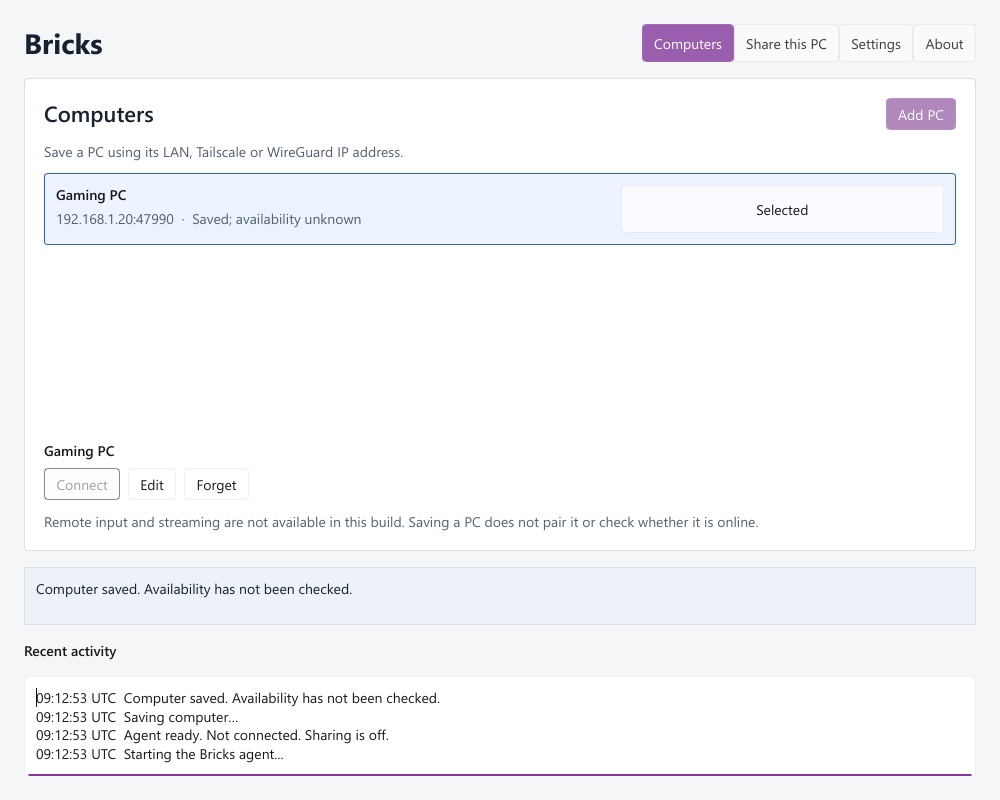

# Bricks



Low-latency remote keyboard and mouse input for Windows, written in Rust.

## Features

- **Desktop GUI** – a Slint app for saving PCs, changing settings, setting up identities and running local checks.
- **Headless agent** – a per-user background service that holds all state. The GUI and CLI tools talk to it over a local named pipe, so it runs fine with no window open.
- **Command-line tools** – `bricks-host`, `bricks-client`, `bricks-lab` and `bricks-bench` for configuration, probes, self-tests and benchmarks.
- **Encrypted QUIC transport** – mutual TLS 1.3, with keys stored using Windows DPAPI.
- **Key recovery** – retries, reordering and cleanup so a dropped packet never leaves a key stuck down.
- **Strict config** – versioned TOML profiles, validated on load.

## Status

Working: the GUI, the agent, encrypted loopback transport and the recovery tests.
Not done yet: live remote input between two PCs, pairing and video streaming. These buttons are disabled in the app.

## Quick start

Double-click **Start Bricks**, or open `dist\BricksDesktop\Bricks.exe`.

Run the recovery self-test:

```powershell
.\target\debug\bricks-host.exe recovery-selftest
```

Run the encrypted loopback probe:

```powershell
.\target\debug\bricks-host.exe probe-selftest 100
```

## Build

Requires Rust 1.99.1 (pinned) and the MSVC build tools.

```powershell
cargo test --workspace --locked
powershell -ExecutionPolicy Bypass -File tools/build-desktop.ps1
```

## Layout

| Crate | Purpose |
| --- | --- |
| `bricks-ui` | Slint desktop app |
| `bricks-agent` | Headless background agent |
| `bricks-control` | Named-pipe SDK shared by the GUI and CLI |
| `bricks-transport` | QUIC, TLS, identities and recovery |
| `bricks-core` | Key state and recovery logic |
| `bricks-protocol` | Wire format |
| `bricks-input-windows` | Windows input capture and injection |
| `bricks-config` | TOML config and validation |
| `bricks-host`, `bricks-client` | Host and client CLIs |
| `bricks-lab`, `bricks-bench` | Stress tests and benchmarks |

More detail is in [docs](docs/README.md).
