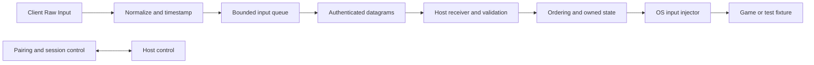

# Architecture

Status: foundation crates, local Windows fixture, authenticated recording-only QUIC probe/recovery harness, Slint desktop and separate per-user agent/IPC SDK subset exist. Real networked Windows capture/injection, external OS cleanup supervision and media remain pending. See [development status](development.md).

## Input path



Healthy input is forwarded immediately. There is no mandatory jitter buffer or synthetic hold scheduler. Loss recovery uses bounded ordering waits and resynchronization as defined in [protocol](protocol.md).

## Proposed workspace

```text
crates/
  bricks-protocol/       wire types, codecs, validation, capability negotiation
  bricks-core/           owned input state, ordering, recovery, time abstractions
  bricks-config/         versioned config, profiles, validation, migrations
  bricks-input-windows/  Windows capture/injection adapters; Linux added separately
  bricks-transport/      Quinn endpoint, pairing identity, datagrams, control
  bricks-client/         capture UI/CLI, local escape, session lifecycle
  bricks-host/           interactive agent, permissions, injection worker
  bricks-bench/          observable receiver fixture and deterministic load generator
  bricks-control/        implemented headless controller and local IPC SDK subset
  bricks-agent/          implemented per-user state/diagnostic runtime
  bricks-ui/             implemented simple Slint product frontend, first slice
  bricks-lab/            single-PC QUIC recovery/lifecycle/resource characterization
  bricks-media/          later capture/codec/media interfaces
  bricks-viewer/         later decode/presentation/audio client
tools/analysis/          offline trace analysis and report generation
docs/                   current design and benchmark specifications
```

Keep protocol and state logic free of OS dependencies. Use explicit adapter interfaces such as `Capture`, `Injector`, `Clock`, `TraceSink`, and `DatagramTransport`. Avoid abstraction layers inside the event loop unless they provide measurable testing or portability value.

Backend factories consume a validated immutable configuration at session creation. Backends advertise capabilities; the session planner checks the selected capture/transport/injection/media combination before taking input ownership. Initial implementations are compiled into the executable; configuration selects registered implementations, not arbitrary DLLs. Adding a backend requires a registered ID, typed options, capability declarations, and adapter contract tests, without changes to unrelated backends. See [configuration](configuration.md).

The shell provides installation, discovery, pairing, saved hosts, and connection status. It uses the same configuration and session planner as the CLI. A shared Windows application can select host or client role at runtime; keep hot-path internals independent of the UI. See [installation and connection](installation-and-connection.md).

The simple Slint product frontend now uses the [per-user agent and restricted Windows pipe SDK](single-pc-agent-and-recovery.md) for saved state, setup and diagnostics. Input/media do not traverse this control channel. The actor driving recording-only network recovery is separate from storage/IPC/UI work. Pairing, live OS input and media remain capability-gated under the [frontend design](frontend-design.md) and [full SDK contract](control-sdk.md). The WinForms launcher is a separate development tool.

## Threads and queue ownership

| Execution context | Responsibility | Constraint |
| --- | --- | --- |
| Client capture/message thread | Drain OS input and normalize events | No disk I/O, crypto handshake, blocking networking, or formatting |
| Transport runtime | Receive/send datagrams; process ACKs and session control | Bounded work and queues; no media work in input callbacks |
| Host injection worker | Apply validated transitions and call OS adapter | Single state owner; no synchronous logging |
| Trace writer | Batch records to disk | Dropping trace records is counted; never blocks input |
| UI/control | Pairing, status, configuration | Outside hot path |
| Later media workers | Capture, encode, packetize, decode, present, audio | Independent bounded stages |

Start with ordinary threads and OS priority. Measure handoff cost before deciding whether receive and injection should share a worker. Use fixed-capacity queues and reused buffers; avoid steady-state heap allocation where practical. A real-time scheduler or busy-spin loop is not a default optimization: it can starve graphics, drain power, and worsen tails.

The recording lab additionally exposes an explicit `games_scheduling` experiment: a scoped Windows MMCSS Games task on its current-thread runtime. Ordinary scheduling remains available. It changes no registry setting, process-wide realtime priority, affinity or recovery deadline; the registration is reverted on its owning thread. Resource sampling is separate from that actor, and maintenance sleeps until its next actionable ACK/retry/watchdog deadline rather than polling every millisecond.

If motion capacity is exhausted, coalesce safely or discard stale motion according to protocol semantics. Never silently discard transitions. If a transition cannot be queued, suspend control, record the fault, and release owned state through the watchdog. Set concrete queue caps during the first measured implementation and document them in the run manifest.

## Platform adapters

Windows capture uses Raw Input with a message pump and buffered draining where beneficial. Scope registration to capture mode; optional hooks handle local suppression only. Guard against capture/injection loops and tag injected events for diagnostics.

Windows injection starts with scan-code `SendInput`, explicit extended-key handling, relative mouse support, and checked insertion counts. API submission and fixture consumption are distinct timestamps. Test elevated targets, fullscreen, mouse lock, pointer acceleration, layout differences, and key rollover. Do not backdate OS timestamps as a substitute for delivering an event on time. A small array of already available events is allowed, provided each transition remains distinct and ordered; waiting to form a batch is not.

Linux capture uses evdev; injection uses uinput with declared capabilities and `SYN_REPORT` boundaries. Do not depend on writing arbitrary physical event devices as a portable fallback. Exclude Bricks-created devices from capture. Device grabs are opt-in and must release on failure. Use per-device permissions rather than running the whole app as root. The [kernel uinput documentation](https://docs.kernel.org/input/uinput.html) describes the virtual-device interface.

## Session security and operational behavior

Use Quinn with TLS peer authentication and locally pinned identities. Pair through explicit local approval and an out-of-band fingerprint verification path. Store private keys using OS-protected storage; log neither secrets nor pairing credentials. Enforce one controlling peer, bounded untrusted message parsing, per-peer rate limits, session epochs, revocation, and no replayable early-data input.

Default to loopback or a configured private/tunnel interface. Being inside a VPN does not authorize every peer to control the host. QUIC provides transport security; the application still owns peer authorization and its event replay/dedup state. See [RFC 9221](https://www.rfc-editor.org/rfc/rfc9221.html) and [Quinn's API](https://docs.rs/quinn/latest/quinn/struct.Connection.html).

Input traces can disclose typed content even without characters. Default observability records aggregate timings/counters. Full event traces require explicit diagnostic activation, a retention limit, and local restricted storage. Asynchronous trace drops invalidate trace-based completeness conclusions.

## Media architecture required for the full goal

```text
Host rendered frame
  -> GPU capture -> GPU color conversion -> hardware encoder
  -> deadline-aware packetization and pacing -> network
  -> bounded reassembly -> hardware decoder -> GPU presentation -> display
Host audio -> small audio blocks -> audio codec/transport -> client audio clock
```

Windows first evaluates DXGI Desktop Duplication versus a Windows Graphics Capture spike on the actual games. Prefer keeping surfaces on the GPU through conversion and encoding. Choose the first encoder backend from the available host GPU: NVENC, AMF, or Intel oneVPL. Use hardware decode on the client. These are candidates, not promised supported backends.

Start at H.264, 1080p SDR/120 FPS for availability; evaluate HEVC/AV1 only where both endpoints support the required mode. Probe capabilities and fail clearly or use an explicitly selected fallback; do not silently compare software decoding against a hardware baseline. Try low-latency presets, no B-frames, and disabled lookahead first. Tune against quality and bandwidth rather than assuming every low-latency setting is free. [DXGI](https://learn.microsoft.com/en-us/windows/win32/api/dxgi1_2/nn-dxgi1_2-idxgioutputduplication) and [NVENC's programming guide](https://docs.nvidia.com/video-technologies/video-codec-sdk/13.0/nvenc-video-encoder-api-prog-guide/index.html) establish available interfaces; speed depends on hardware and configuration.

Keep at most one pending raw frame before encode and one pending decoded frame before presentation as an initial queue policy. Supersede stale raw/decoded frames, but never drop arbitrary compressed reference frames: dependent frame loss requires dependency-aware discard and recovery/refresh. Bound frame reassembly by deadline, request refresh when necessary, and count displayed frame age and stalls. Congestion control must reduce media rate before sustained queue growth.

Start with separate input and media QUIC connections to avoid shared transport scheduling. They still share NIC and network queues: separate connections alone do not guarantee priority. Reserve a small paced input budget and ensure aggregate congestion behavior is safe. Benchmark shared versus separate transports before finalizing.

Presentation policy (VSync, tearing, frame pacing, VRR) is explicit and matched in comparisons. Local cursor rendering can improve pointer feel but does not count as a remote game response. Audio uses a media clock with bounded buffering and drift correction, without forcing video to wait for excessive audio delay. HDR, multiple monitors, surround audio, controller feedback, and encoder-vendor expansion follow the first full-stack proof.
